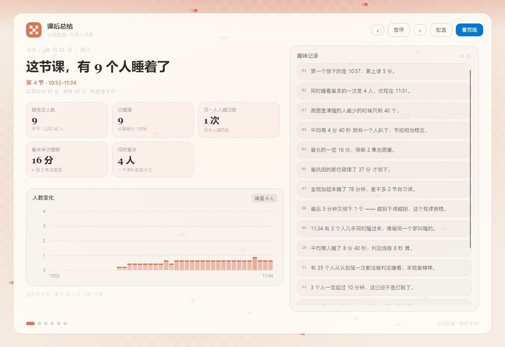
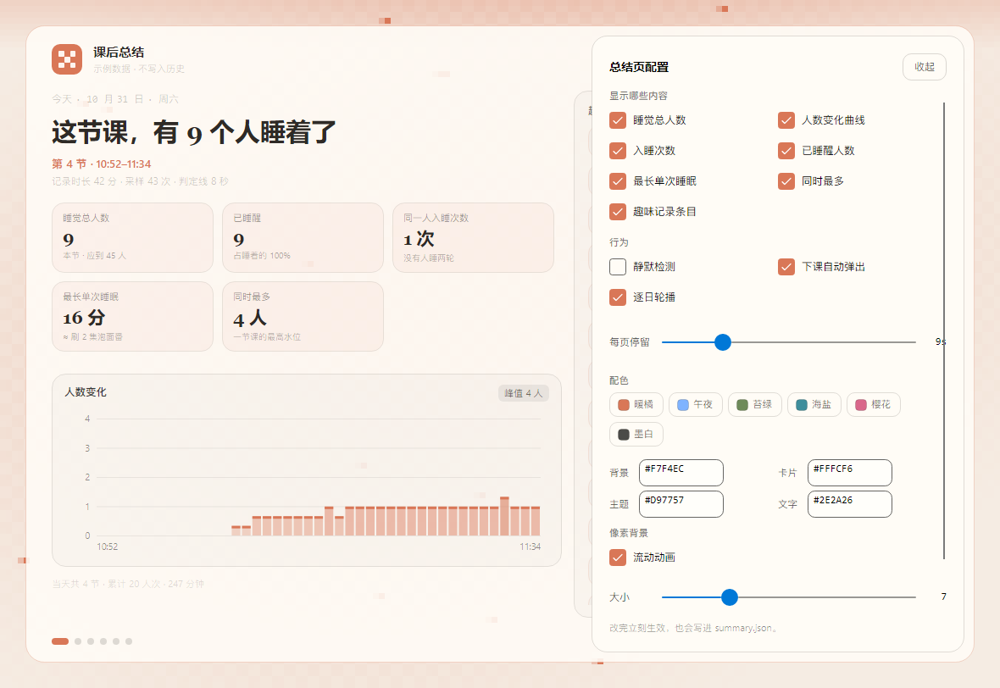

<div align="center">


**接一路教室摄像头，实时算出画面里有几个人疑似睡着，直接显示在 ClassIsland 主界面。**

一个纯本机、不认人、不联网的 ClassIsland 插件。

[简体中文](README.md)

[](../../releases)
[](https://classisland.tech)
[](https://dotnet.microsoft.com)
[]()
[]()
[](LICENSE)
[](../../stargazers)

作者：**ShirakawaFM / 白川方明**

</div>

> ⚠️ **这是一个娱乐向插件。** 它不保证准确，也不应该被当作考勤或纪律工具。85% 左右的检出率是这类方案的现实水平；数字看看就好，别拿去点名。

---

## 目录

- [这是什么](#这是什么)
- [为什么不做「识别闭眼」](#为什么不做识别闭眼)
- [它到底怎么判断](#它到底怎么判断)
- [安装](#安装)
- [快速上手](#快速上手)
- [主界面组件](#主界面组件)
- [课后总结](#课后总结)
- [课表联动：怎么知道"上课了""下课了"](#课表联动怎么知道上课了下课了)
- [参数与调优](#参数与调优)
- [准确率、机位与分辨率](#准确率机位与分辨率)
- [隐私与边界](#隐私与边界)
- [常见问题](#常见问题)
- [自行编译](#自行编译)
- [目录结构](#目录结构)
- [路线图](#路线图)
- [版本记录](#版本记录)
- [致谢与许可](#致谢与许可)


## 这是什么

一个 ClassIsland 插件。它把「谁睡着了」这件原本要靠老师抬头扫一眼的事，变成主界面上的一个数字：

```
疑似睡着 3 人 · 在座 38/45
```

它做四件事，只做这四件事：

1. **抓画面**：从一路摄像头（USB 编号或 RTSP 地址）按固定帧率取帧。
2. **找人和姿态**：YOLOv8n-pose 一次给出「画面里有几个人」，以及每个人 17 个关键点。
3. **猜睡意**：对每个人单独计时。很久没被看到睁眼，或者头一直低着，就归到「疑似睡着」。
4. **出数字**：汇总成「在座 / 疑似睡着 / 判断不了 / 未观测」，喂给主界面组件和设置页预览。

典型场景是自习课、晚自习、连堂课的后半段——教室里安静下来，谁趴下去了其实一眼能看见，但老师站在讲台上看不见最后一排。这个插件就是把最后一排那几颗低下去的头，搬到屏幕上。

### 它不做什么

| 不做 | 原因 |
| --- | --- |
| 不认人 | 不做人脸识别、不比对身份库、不关联学号，输出永远只有人数 |
| 不画网格 | 不需要标定座位、框人脸，填个摄像头编号就能跑 |
| 不存画面 | 原始帧只在内存里过一遍，不写盘、不上传 |
| 不联网 | 模型随插件打包，装好即用，断网无影响 |
| 不判断「困」 | 它只看姿态和睁眼，不猜情绪、不看表情、不做注意力评分 |


## 为什么不做「识别闭眼」

因为物理上不成立。

1080p 的画面，摄像头装在教室后面 10 米处，一个头大概只有 **20 个像素**，眼睛不到 **10 个像素**。在这个尺度上，不要说判断睁眼闭眼，连「这是眼睛还是眼镜反光」都分不清。换 4K 也只是把这个数字翻一倍，仍然远低于可靠判别的下限。

所以这个插件反着做：

> **只要能抓到你睁眼，你就一定是醒着的。**

不需要判断「闭眼」，只需要判断「有没有在睁眼」。剩下的那些人——很久没被看到睁眼、或者头一直低着——才是疑似睡着。这个方向对分辨率的要求低一个数量级，而且**宁可漏报，也不误报**：

- 背对镜头 → 看不到眼睛 → 归到「判断不了」，不算睡着；
- 被前排挡住 → 同上；
- 头发挡脸 / 逆光过曝 → 眼部区域一片平 → 「判断不了」；
- 只有明确看到「这个人刚才眼睛是睁开的，然后 N 秒都没再睁开」，才计一次睡着。

这就是为什么设置页里会有一栏黄色的「判断不了」。**黄框多，说明机位不行，不是算法不行。**


## 它到底怎么判断

### 单帧：两把尺子

| 信号 | 怎么算 | 为什么这样算 |
| --- | --- | --- |
| **头低没低** | `(肩线中点 Y − 鼻/眼中点 Y) ÷ 肩宽` | 用肩宽做分母，等于把人「归一化」了。近排远排、大人小孩共用同一把尺，换机位不用重新标定 |
| **睁没睁眼** | 左右眼关键点邻域的**暗像素占比** | 睁眼时虹膜和睫毛贡献暗像素，闭眼时眼睑是一片平的肤色。阈值可调，默认 0.10 |

两个信号都是**相对量**，不依赖绝对像素尺寸，也不需要知道人和摄像头有多远。

### 多帧：一条轨迹一套计时器

单帧结果噪声很大——一帧看错、一帧漏检都很正常。所以每个人在系统里有一条**轨迹**，靠前后帧的人体框 IoU 关联（不认身份，只认「这个框和上帧那个框重叠得多」）：

```text
抓到睁眼            →  记一次「清醒」，低头计时清零
头低着（姿态估计）    →  累计低头时长，抬头清零
──────────────────────────────────────────
每帧结算：
  疑似睡着 =（刚才能看清眼睛，且已 N 秒没睁眼）
          或（头一直低着超过 N 秒）
  判断不了 = 看到了人，但眼睛看不清、姿态也判断不了
  未观测   =  应到人数 − 画面里找到的人
```

几条容易被忽略但很关键的设计：

- **轨迹有记忆。** 学生转头、被前排挡一下、模型漏检一两帧，都不会让计数瞬间归零。「在座记忆」默认 6 分钟，就是这个记忆的长度。
- **清醒优先。** 只要这一帧抓到了睁眼，立刻重置睡着计时。睡觉的人不会频繁睁眼，醒着的人一定会——这个不对称是整套逻辑的地基。
- **不在场 ≠ 睡着。** 画面里没找到的人进「未观测」，不会被算进睡着人数。
- **IoU 关联不需要人脸。** 两帧之间同一个人位置只会小幅移动，重叠度足够区分「谁是谁」，也就避免了任何身份识别。

### 状态机

| 状态 | 进入条件 | 退出条件 |
| --- | --- | --- |
| 未观测 | 本帧没找到这个人 | 再次匹配到轨迹 |
| 判断不了 | 找到人，但眼部不可判 / 姿态缺失 | 拿到有效信号 |
| 清醒 | 抓到睁眼 | 连续 N 秒没再抓到 |
| 疑似睡着 | 连续 N 秒没睁眼，或持续低头超 N 秒 | 抓到一次睁眼 |

## 安装

**前置条件：ClassIsland 2.1.1.1 或更高。** 插件按 `apiVersion 2.1.1.1` / .NET 10 编译，1.x 的加载器会直接拒收，而且不给任何提示。

从 [Releases](../../releases) 下载 `ClassIsland.SleepWatch.cipx`（约 49 MB，含姿态模型），任选一种装法：

| 方式 | 步骤 | 适合 |
| --- | --- | --- |
| **拖进去** | 把 `.cipx` 直接拖到 ClassIsland 主窗口上 | 最省事 |
| **从本地装** | 应用设置 → 插件 → 从本地安装 → 选中文件 | 常规 |
| **手动解压** | 关掉 ClassIsland，用 7-Zip 解到 `data/Plugins/classisland.sleepwatch/` | 排查问题 |

装完重启 ClassIsland，在插件列表里启用「SleepWatch 课堂睡意监测」。

> 2.x 的插件目录是 `data/Plugins`，不是 `app-x.y.z/Plugins`。放错位置的表现是「装了但列表里没有」。

## 快速上手

1. 打开【应用设置 → 睡意监测】；
2. **视频源**填 `0`（第一个摄像头）或 `1`；网络摄像头填 `rtsp://...`；
3. 点【重启监测】，页面上方的实时画面开始出图；
4. 看框的颜色对不对：坐着头抬着应该是绿框，趴下去的会在一段时间后变红；
5. 觉得误报多，把**睡眠判定秒数**往右拖到 15~20；觉得反应慢就往左拖。

所有参数都是滑动条，松手自动保存，但**要生效需要点一次【重启监测】**——引擎是按参数快照起线程的，改参数不会打断正在跑的推理。

第一次用建议这样验证：

- 自己坐到镜头前，抬头 → 应该是绿框；
- 趴到桌上 10 秒以上 → 应该变红；
- 背对镜头 → 应该变黄（判断不了），而不是变红。

如果第二步不红、第三步反而红了，说明机位或阈值不对，先看[调优](#参数与调优)。


## 主界面组件

组件有三种显示方式，在组件的独立设置里切换：

| 模式 | 效果 | 适合 |
| --- | --- | --- |
| 详细 | `疑似睡着 3 人` + `在座 38/45` | 教师自己看 |
| 紧凑 | `睡 3` | 主界面空间紧张 |
| 只显示状态 | `状态不错` / `有点乏了` / `倒下一片` | **投在教室大屏上时用这个** |

> 如果组件是投在教室大屏上的，强烈建议用「只显示状态」。具体数字一旦被学生看到，他们很快会学会躲镜头、用书挡脸、故意低头试探，数据反而失真，师生关系也会变得微妙。

组件还支持**跟着课表走**：上课自动开始、下课自动停止。这样既省 CPU，也避免在课间空教室里跑一个没人需要的推理。

## 课后总结

主界面那个数字，只在你抬头看的时候有用。课后到底睡成什么样，得等下课回头看。

1.2 版加了**静默检测**：照常检测，但课堂上什么都不弹、不改界面，只把谁在什么时候睡着、睡了多久、
什么时候醒了一条条记下来。下课铃一响，账本交给课后总结。

### 记的是什么

| 记录 | 粒度 | 用途 |
| --- | --- | --- |
| 睡眠事件 | 每次「睡着 → 醒来」一条 | 人数、次数、时长全靠它算 |
| 人数曲线 | 每 20 秒一个采样点 | 画"这节课几个人在睡"的变化 |
| 峰值 | 每节课取最大值 | 一句话说明"最惨的时候几个人趴着" |

一个人的睡眠事件靠轨迹编号串起来：同一个人睡了两轮，就是两条事件、同一个编号，所以"同一人入睡次数"是算得出来的；但**认不出是哪位同学**，所以报告里只有编号和位置，不会出现名字。

### 窗口里有什么

一个小弹窗（920×640，居中、置顶 2.5 秒、`Esc` 直接关），不抢全屏。每页只放**一个巨型数字 + 三个关键词 + 一张会长的图**，扫一眼就够。版式按区域拆开是这样的：

| 位置 | 放什么 | 示例 |
| --- | --- | --- |
| 左上 | 日期、第几节、时段 | `今天 10 月 31 日 周六` · `第 5 节 11:41-12:23` |
| 左侧 | 巨型数字 + 单位 + 应到人数 | **9** 睡觉总人数 · 本节应到 45 人 |
| 左中 | 一句话结论 | 这节课有 9 个人睡着了 |
| 左下 | 三个关键词 | 已睡醒 3 · 入睡 2 次 · 最长 18 分 |
| 右上 | 人数曲线 + 峰值 | 20 秒一根的像素柱，峰值 4 人 |
| 右下 | 记一笔（最多 3 条，多了轮换） | 01 第一个倒下 11:57 · 02 同时最多 4 人 |

- **巨型数字**：这一页的主角，从 0 滚到目标值
- **三个关键词**：已睡醒、同一人入睡次数、最长单次睡眠；勾了「同时最多」就多一个
- **人数曲线**：一列一列的像素柱，20 秒一根，峰值不会被降采样抹平
- **记一笔**：趣味记录，最多三条，多了轮换
- **末页**：这几天加起来的账，图换成「每天睡过的人数」



<div align="center"><sub>图里的数字来自内置示例数据，不是真实班级</sub></div>


### 页序与收尾

固定顺序，自己往下走：

```text
上节课总结  →  昨天  →  前天  →  总计  →  自动关闭
```

每页停留 7 秒（可调 3~30 秒），末页停 4.5 秒就自己关掉，不用手动点。中途想停就按【暂停】，想往回翻就按 `←`。

### 动画怎么做的

**一条时间轴，60fps。** 所有动画都挂在 `TopLevel.RequestAnimationFrame` 上，跟显示器垂直同步对齐，
而不是 `DispatcherTimer`（16ms 的定时器实际会抖成 16/32/48，看起来就是一顿一顿的）。

| 元素 | 入场 |
| --- | --- |
| 整块内容 | 0.15 → 1 淡入，上浮 10px |
| 巨型数字 | 0 滚到目标值，0.05~0.9 区间 |
| 关键词卡片 | 依次浮起，每张晚 70ms |
| 趣味记录 | 依次浮现，每条晚 80ms |
| 柱状图 | 柱子从零依次弹出，从左往右扫过；折线只连已经长完的柱子，不会飘在空中 |
| 峰值标记 | 全部长完后再亮一条虚线 |

时间基准用真实帧时间，掉帧只会少画几帧，不会让动画变慢或者突然跳一下。

### 趣味记录是怎么来的

不是随机文案，全部由这堂课的数据现算，算不出来就不写。比如：

- 第一个倒下的是几点、离上课多久
- 平均多少分钟倒下一个人
- 最长的一觉够刷几集泡面番
- 有个位置睡了 3 次，醒了又睡
- 下课铃响时还有几个人没醒
- 画面左半边倒了 6 次、右半边只有 2 次
- 最后 5 分钟又倒下几个
- 和昨天比、和上一节比，多了还是少了

一共 20 多条判据，按顺序取前 20 条成立的。一节课没人睡，就只显示一句"这节课一个人都没睡"，不会硬凑。

### 视觉

整页是暖米色纸感 + 衬线大标题 + 陶土色点缀（就是 Claude 那种调子），背景是一层**会流动的像素**：

- 先渲染一张约 110×80 的小位图，再用最近邻放大铺满窗口 —— 硬边像素块是放大的副产物，不用画几万个矩形
- 每帧只做整数加法和查表（正弦值预存在 1024 长度的表里），60fps 下 CPU 基本感觉不到
- 三层不同速度的正弦场叠出慢慢漂移的"热斑"；一道扫描带每 7 秒走一趟；十几颗亮点按固定节拍**整格跳动**，不是平滑滑动
- 配色可以整套换：内置暖橘 / 午夜 / 苔绿 / 海盐 / 樱花 / 墨白六套预设，也能直接填四个十六进制颜色

### 配置

窗口右上角【配置】拉开就是一个抽屉，勾选框直接控制显示哪些块（总人数 / 曲线 / 入睡次数 / 已睡醒 / 最长单次 / 同时最多 / 趣味条目），另有：

- 静默检测开关（关掉就是原来的"主界面直接显示人数"）
- 下课是否自动弹总结
- 是否逐日自动轮播、每页停留几秒、末页是否自动关
- 像素块大小、流动动画开关

所有改动即时生效，写进 `summary.json`；历史存在 `history.json`，保留 120 天。



### 两个刻意的选择

**没睡过就不弹。** 一节课零记录时窗口不会出现——每节课都弹一个"0 人睡觉"的窗口，只会让人想把它关掉。

**只记事件，不存画面。** 整个流程里没有任何一帧画面落盘，图像只在内存里过一遍就丢。课后总结能画出曲线，但永远不可能回放"谁在什么时候趴下"。

### 数据放在哪

```text
%AppData%\ClassIsland\SleepWatch\
├─ history.json   每节课的睡眠事件与曲线（保留 120 天，超过自动清）
├─ summary.json   总结窗口的显示项与配色
└─ settings.json  检测参数
```

课上每 3 分钟也会落一次盘，教室电脑被直接断电最多丢 3 分钟。


## 课表联动：怎么知道"上课了""下课了"

下课那一刻要弹总结，前提是**知道下课铃什么时候响**。这件事不靠猜、也不靠用户点按钮，直接问 ClassIsland 要课表。

### 拿到的数据长什么样

```text
ILessonsService.GetClassPlanByDate(日期)  →  ClassPlan
├─ Name / IsEnabled                       这一天的课表名、有没有启用
├─ ValidTimeLayoutItems : 时间片列表         ← 真正的时刻表
│   ├─ TimeType   0=上课  1=课间  2=分割线  3=行动
│   ├─ StartTime / EndTime : TimeSpan
│   └─ BreakNameText                      课间叫什么（"大课间"）
└─ Classes : 课节列表
    ├─ Index     第几节
    └─ SubjectId → Profile.Subjects[Guid].Name   科目名
```

类型为 2、3 的时间片是零长度的标记（分割线、行动），不占时间，解析时直接跳过；`EndTime <= StartTime` 的脏数据也丢掉。

插件内部再折成两个自己的类型，好处是判定逻辑完全不依赖 ClassIsland 的类型，能单独跑自检：

```csharp
sealed class ScheduleBlock { int Index; BlockKind Kind; TimeSpan Start, End; string Label; }
//   Kind = Class / Break，Covers(t) 判断某一时刻在不在这一片里

sealed class ScheduleDay   { DateTime Date; IReadOnlyList<ScheduleBlock> Blocks;
                             ScheduleBlock? BlockAt(TimeSpan); ScheduleBlock? NextClassAfter(TimeSpan); }
```

### 判定：以时钟为主，事件为辅

**每秒钟查一次表**，而不是等事件。事件会漏（切课表、改时间、插件重载），时钟不会。

```text
每秒：
  课表不可用？→ 保持当前状态，90 秒宽限期内不乱结课
  这一秒落在某个"上课"片里？ → InClass
  落在"课间"片里？           → Breaking
  早于第一节？               → BeforeSchool
  晚于最后一节？             → AfterSchool
  落在两片之间的缝里？        → Breaking
```

几条刻意写死的规则：

| 情况 | 处理 |
| --- | --- |
| 状态要变了 | 只有**真的跨过课表边界**才立刻生效；否则要求连续两拍一致，防止抖动 |
| 下课结算时刻 | 取**课表上的**下课时刻，不是定时器醒来的时刻——卡一下不会把课时算长 |
| 系统休眠 / 时钟前跳 > 90 秒 | 按中断前最后一拍以 `Wake` 结算，然后重开，不弹窗 |
| 时钟回退（网络校时） | **只提示、不结算**，正在上的课继续上 |
| 一节课超过 3 小时 | 按 `Truncated` 截断，避免忘记关电脑时记账记到天亮 |
| 手动模拟上课 | 进了模拟就一直听模拟的，直到手动结束，课表说了不算 |

结算原因一共五种：`Timetable`（正常下课）/ `SchoolOver`（放学到点）/ `Wake`（休眠唤醒）/ `Truncated`（超长截断）/ `Manual`（手动结束）。只有前两种会弹总结，其余都不打扰。

### 弹窗之前先来一记强提醒

下课的瞬间屏幕上一片安静，一个小窗口很容易被忽略。所以先借 ClassIsland 自己的提醒通道发一条：

```csharp
NotificationProviderBase.ShowNotification(new NotificationRequest {
    MaskContent = new NotificationContent { Content = "这节课睡倒 9 个人", Duration = 8s }
});
```

用宿主现成的 provider，走的是用户已经配好的提醒样式（声音、位置、动画），不自己造一个新窗口。两条提醒之间至少隔 20 秒，防止连环弹。强提醒之后 1.1 秒才弹总结窗口——先让人抬头，再让人看细节。

### 试弹：不用等 45 分钟

调视觉的时候等下课铃是不现实的。设置页「结果试弹」有三个按钮：

| 按钮 | 干什么 |
| --- | --- |
| 【真实记录】 | 直接拿账本里已有的记录弹，验证"下课之后到底长什么样" |
| 【合成数据】 | 用固定种子现场造几天，改一次配色就能重弹一次 |
| 【换一版】 | 换个种子再弹，连着看不同的人数曲线 |

试弹**不写历史**，弹一百次也不会污染 `history.json`；账本里一条记录都没有时，会自动落到合成数据并在设置页说明原因。

同一个设置页还有「课表同步」区块，实时显示：当前处于什么阶段（未上课 / 上课中 / 课间 / 放学后）、当前是哪一节、下一节几点、课表是否同步成功，以及【模拟上课】【模拟课间】两个手动入口——不用改系统时间就能把整条链路走一遍。


## 参数与调优

| 参数 | 默认 | 范围 | 说明 |
| --- | --- | --- | --- |
| 视频源 | `0` | 编号或 URL | 摄像头编号，或 `rtsp://` / `http://` 地址 |
| 处理帧率 | 4 | 1~15 | 每秒分析几帧。判「几秒没睁眼」不需要高帧率，调高只是白烧 CPU |
| 推理宽度 | 640 | 320~1920 | 送进模型的画面宽度。卡就降到 480，前排特写可提到 960 |
| 应到人数 | 45 | 1~100 | 只用来算「未观测」，填个大概 |
| **睡眠判定秒数** | **8** | 2~120 | **核心参数**。几秒没睁眼 / 一直低头就判疑似睡着 |
| 在座记忆 | 6 | 1~60 分钟 | 多久没看到这个人，就不再算「在座」 |
| 睁眼阈值 | 0.10 | 0.02~0.50 | 眼部暗像素占比阈值。闭眼被判睁眼就调高，逆光睁眼被判闭眼就调低 |

### 调参顺序（别一上来就乱拖）

1. **先调机位**：摄像头放教室**后方**，俯角 20°~30° 往下拍，比举在讲台上正脸拍强得多，遮挡少一大半；
2. **再看黄框比例**：黄框超过三成，说明眼睛根本看不清，调阈值没用，得换机位或加光；
3. **然后调秒数**：误报多 → 加秒数（15~20）；漏报多 → 减秒数（5~6）；
4. **最后调阈值**：只在「明明睁着眼却一直是红的」或「闭着眼却一直是绿的」时动它；
5. **帧率别动**：4 FPS 对「8 秒」这个尺度绰绰有余，调到 15 只是让 CPU 从 25% 涨到 80%。

### 资源占用

| 项目 | 实测（i5-1135G7 / 无独显） |
| --- | --- |
| CPU | 单核约 25%~35%，4 FPS、推理宽度 640 |
| GPU | 不需要 |
| 内存 | 约 300 MB（含 ONNX Runtime 与模型） |
| 网络 | 零 |
| 硬盘 | 除插件本身外不写任何文件 |

推理在后台线程跑，主界面不卡；关掉设置页的预览会进一步降负载（预览帧要额外做一次绘制）。

## 准确率、机位与分辨率

老实说，这套东西的准确率高度依赖机位，下面是实测区间：

| 视角 | 检出比例 | 误报比例 |
| --- | --- | --- |
| 正对前 3 排，光线可控 | 约 85% | 10~15% |
| 全教室广角（10 米外） | 60~70% | 25~35% |
| 侧面 / 后方俯拍 | 75~85% | 15~20% |

后排精度上不去的根本原因是分辨率：1080p 画面上 10 米外，人头约 20 像素、眼睛不到 10 像素，这个尺度下任何算法都是猜。**最划算的改进不是调参，是换机位。**

另外几个会让人怀疑「算法坏了」但其实不是的情况：

- **刚上课就报睡着** —— 判定秒数太短，人低头捡笔也会被算进去；
- **一直显示 0** —— 摄像头被别的程序占用（微信、钉钉、浏览器会议），画面是黑的但状态还是「监测中」；
- **数字忽高忽低** —— 应到人数填错，或者画面里有人走动导致轨迹频繁新建；
- **全员判断不了** —— 逆光。摄像头正对窗户时，眼部区域直接过曝，暗像素占比永远是 0。


## 隐私与边界

- 摄像头画面**只在本机内存里处理**，不写盘、不上传、不存储；
- 不做人脸识别、不比对身份库、不关联学号，对外输出**只有人数**；
- 离开设置页立即停止取图；不点【重启监测】就不开摄像头；
- 插件不发任何网络请求，模型随包分发，断网可用；
- 没有遥测、没有统计、没有崩溃上报。

但要说清楚：**教室不是私密空间，持续采集全班画面仍然属于敏感处理**。涉及未成年人时，请先取得学校与监护人同意，并明确告知采集范围与用途。这个插件的定位是「让老师少抬一次头」的玩具，不是监控系统。如果你需要的是可追责的考勤或纪律记录，那它从设计上就不适合——它连「是谁」都不肯告诉你。

## 常见问题

**装了但插件列表里没有**
ClassIsland 版本低于 2.1.1.1。1.x 加载器会直接拒收 `apiVersion 2.1.1.1` 的包，而且不给任何提示。

**状态显示「缺少姿态模型」**
插件包解压不完整。检查 `models/yolov8n-pose.onnx`（约 13 MB）在不在插件目录里，状态栏会把实际找过的路径一条条列出来。

**画面是黑的，但状态是「监测中」且有 FPS**
摄像头被别的程序占用了。关掉那些程序，或者把视频源换成 `1` 试试。

**数字明显虚高**
后排遮挡是主因。先把「睡眠判定秒数」调到 15~20，再看预览里是不是有一堆黄框——黄框多说明机位角度不好，不是算法问题。

**能不能认出是谁在睡**
不能，这是设计上的取舍。一旦要报「谁睡了」，就变成另一种监管强度，也要处理个人信息合规问题，远超一个娱乐插件的范围。

**能不能同时接两路摄像头**
不能。一路摄像头对应一个引擎实例，多路需要跑多个 ClassIsland 实例，或者等后续版本做多源支持。

**为什么设置页关了预览还在跑**
预览只是画面输出，引擎本身是独立的。要让引擎停下来，点【停止监测】或者关掉课表联动。

## 自行编译

需要 .NET 10 SDK：

```bash
git clone https://github.com/ShirakawaFM/ClassIsland.SleepWatch.git
cd ClassIsland.SleepWatch
dotnet build -c Release -p:CreateCipx=true -p:PowershellBinaryName=powershell
```

产物在 `cipx/ClassIsland.SleepWatch.cipx`。Windows 上也可以直接双击项目里的 `pack.cmd`。

> `PowershellBinaryName` 必须显式传：PluginSdk 的 targets 文件里写死了 `pwsh`（PowerShell 7），只有 Windows PowerShell 5.1 的机器会在这里报 9009。

打包脚本会自动做两件事：把 `models/yolov8n-pose.onnx` 塞进包，以及删掉 OpenCvSharp 里用不到的 x86 原生库（包体从 72 MB 降到 47 MB）。

## 目录结构

```text
ClassIsland.SleepWatch/
├─ manifest.yml                 插件清单（id / apiVersion / 作者）
├─ Plugin.cs                    入口：注册组件、设置页、引擎
├─ assets/                      README 用的动态 SVG（banner / flow / divider / footer）
├─ docs/                        总结窗口的界面截图（示例数据）
├─ models/yolov8n-pose.onnx     姿态模型，随插件分发
├─ Controls/
│  ├─ PixelFlowBackground.cs    像素流动背景（小位图 + 最近邻放大 + 整数运算）
│  └─ SleepCurveChart.cs        人数变化曲线（像素柱 + 折线 + 坐标轴）
├─ Services/
│  ├─ PoseDetector.cs           YOLOv8n-pose：预处理 → 推理 → NMS → 17 关键点 → 低头 / 睁眼判定
│  ├─ PersonTracker.cs          轨迹关联 + 每人计时状态机（核心逻辑，可脱离摄像头单测）
│  ├─ DetectionEngine.cs        后台线程：抓帧 → 分析 → 结算 → 画标注 → 输出预览帧
│  ├─ DetectionSettings.cs      参数模型 + settings.json 读写
│  ├─ ModelManager.cs           模型定位（插件目录 → 配置目录，不联网下载）
│  ├─ NativeBootstrap.cs        原生库解析（插件独立加载上下文里的 P/Invoke）
│  ├─ LessonBridge.cs           课表事件桥（按名字订阅，三处各自监听）
│  ├─ SleepModels.cs            数据模型：一次睡眠 / 一节课 / 一天
│  ├─ SleepLedger.cs            静默记账：睡眠事件、曲线采样、history.json
│  ├─ SummaryModels.cs          数据模型汇总 + 把一天折成一页幻灯片
│  ├─ FunFacts.cs               20 多条趣味条目的生成规则
│  ├─ SummarySettings.cs        总结页配置 + 配色预设（summary.json）
│  └─ SummaryHost.cs            下课结算 → 弹窗 → 定时落盘
├─ Components/                  主界面组件 + 组件独立设置
└─ Views/
   ├─ SleepWatchSettingsPage    全局设置页（滑动条参数 + 内嵌实时画面 + 状态栏）
   └─ SummaryWindow             课后总结窗口（幻灯片 + 曲线 + 趣味条目 + 配置抽屉）
```

几个踩过的坑，写给想改代码的人：

- 模型路径必须用 `Assembly.Location` 定位，**不能用 `AppContext.BaseDirectory`**——后者指向 ClassIsland 主程序目录，不是插件目录；
- OpenCvSharp 的原生 DLL 在插件的独立加载上下文里找不到，需要 `NativeBootstrap` 注册 `DllImportResolver`，按插件目录和 `runtimes/win-x64/native` 两处查找；
- 配置文件兜底写到 `%AppData%\ClassIsland\SleepWatch`，因为插件目录在安装后可能只读；
- 预览帧用 `WriteableBitmap` 直接写像素，别每帧新建 Bitmap，否则 Gen0 GC 会把帧率拖死。

## 路线图

- [x] 姿态 + 睁眼双信号判定
- [x] 主界面组件（三种显示模式）
- [x] 课表联动（上课自动开始）
- [x] 设置页内嵌实时预览 + 滑动条参数
- [ ] 多路摄像头
- [ ] 每帧耗时曲线（设置页里画一条折线，方便判断是不是该降分辨率）
- [x] 静默检测 + 课后总结窗口（逐日幻灯片、20 条趣味记录）
- [x] 历史曲线：一节课内的睡着人数变化
- [ ] 导出当日统计为 CSV（只到人数级别，不含画面）
- [ ] 周报：把一周的曲线叠在一张图上

## 版本记录

**1.3.0**
- 课后总结重做成小弹窗（920×640）：一个巨型数字 + 三个关键词 + 一张会长的图，末页自动关
- 全部动画改挂 `RequestAnimationFrame`，跟垂直同步对齐跑满 60fps；数字滚动、卡片浮起、柱子从左往右扫过都按真实帧时间推进
- 末页换成"每天睡过的人数"柱状图，最后一张图也有入场动效
- 下课先经 ClassIsland 提醒通道发一条强提醒，1.1 秒后再弹总结
- 课表联动重写：每秒查表判定上课/课间/放学，事件只做辅助；休眠、校时回拨、超长课时都有兜底
- 设置页新增「课表同步」实时状态与「结果试弹」（真实记录 / 合成数据 / 换一版）
- 「已睡醒」改成按人数统计（原来按次数，可能多于睡着的人数）

**1.2.0**
- 新增静默检测：课堂上只记账不打扰，每人每次入睡都记成一条事件
- 新增课后总结窗口：自动弹出、非全屏、按天分页轮播这几天
- 五个核心指标 + 20 多条由真实数据生成的趣味记录
- 像素流动背景、像素柱状曲线，六套配色预设 + 自定义十六进制颜色
- 配置抽屉：勾选控制显示项、轮播间隔、像素大小、静默开关
- 课表事件改成按名字订阅，组件 / 设置页 / 总结互不顶掉

**1.1.0**
- 设置页内嵌实时画面，取消原来的独立预览窗口
- 参数输入全部改成滑动条，拖动后 400ms 防抖自动保存
- 补齐作者信息、项目地址与开源许可
- README 重写：加入数据流图、调参手册、机位与分辨率说明

**1.0.0**
- 首个版本：姿态 + 睁眼信号判定，主界面组件，课表联动

## 致谢与许可

- 姿态模型来自 [Ultralytics YOLOv8](https://github.com/ultralytics/ultralytics)（AGPL-3.0）；
- 图像采集与处理用 [OpenCvSharp](https://github.com/shimat/opencvsharp)（Apache-2.0）；
- 推理后端为 [ONNX Runtime](https://github.com/microsoft/onnxruntime)（MIT）；
- 宿主平台 [ClassIsland](https://github.com/ClassIsland/ClassIsland)（MIT）。

本插件自身以 [MIT](LICENSE) 开源，© 2026 ShirakawaFM / 白川方明。使用模型时请一并遵守其原始许可。


